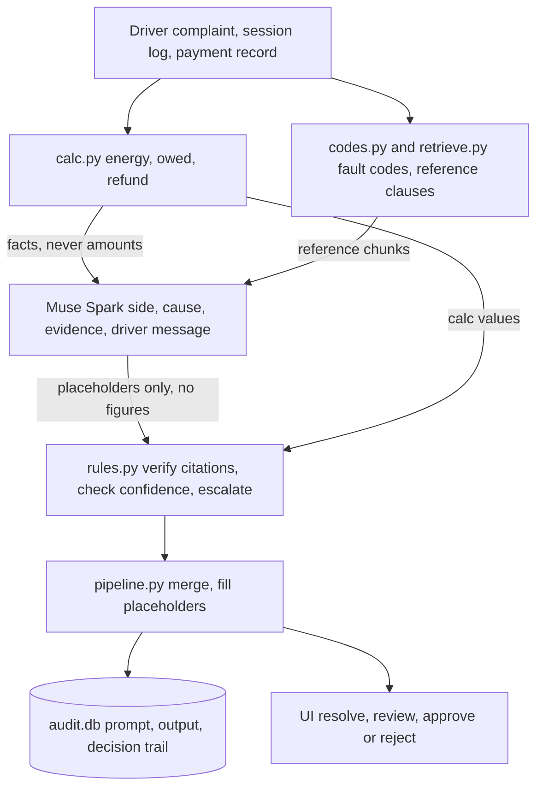

# EV-Failed-Session Resolver

Built for the Meta hackathon.

All data in this demo is synthetic.

30-second pitch: when an EV charging session fails, drivers and support agents get
conflicting numbers — what the car drew, what the charger delivered, what was
refunded. This tool reconstructs the failed session from the raw inputs, resolves
exactly what is owed or refunded using auditable code-only arithmetic, and
escalates only the cases a human must see. The model explains; it never computes
money.

> Status (Oct 28, Session 10): Sessions 0–6, 8, 9 implemented, 75 tests
> passing. Session 7 (Meta client) implemented Oct 28 from the docs at
> dev.meta.ai (muse-spark-1.3, POST /chat/completions, Bearer key,
> temperature 0.2, json_object mode); one live call from the human's
> machine still needed to confirm. UI direction changed Oct 28 (human decision): Streamlit
> removed, replaced by FastAPI (api.py) + Next.js (web/), Cases page first.
> Still human-owned: eval cases/labels, corpus summaries, browser check,
> and all commits.

## How to run and test

Prereqs: Python 3.11+ and Node 18+.

```sh
python -m venv .venv && . .venv/bin/activate
pip install -r requirements.txt
(cd web && npm install)
.venv/bin/python -m pytest -q   # expect all green
./start-dev.sh                  # API on :8000, UI on :3000
```

Open http://localhost:3000. No API key needed: the default `fake`
client uses canned replies and the UI banners it. For live model output,
`cp .env.example .env`, set `META_API_KEY` and `RESOLVER_CLIENT=meta`,
and restart. `.env` is gitignored. Never commit keys.

Tester walkthrough (about 5 minutes):

1. Cases: pick C-014 and press Resolve, or paste case JSON under
   "Analyse pasted JSON" (no file needed).
2. Read the verdict strip: side, confidence, escalation status, refund draft.
3. Left pane shows the complaint and session log (cited rows highlighted);
   right pane shows the diagnosis. Click an evidence ref to jump to its row.
4. No escalation: write a decision note, press Approve, see the recorded
   decision. Escalated (try C-021): there is no Approve button — review the
   reasons instead.
5. Audit: every run lands here with its raw model output; filter by decision.
6. Evaluation: compare model vs code-only baseline once `eval/results.json`
   exists (commands below).

If no cases exist yet, the Cases page shows a sample case with a copy
button — save it as `eval/cases/C-014.json`, add its label row to
`eval/labels.json` (both human-written), and refresh.

Eval harness (needs the human-written cases and labels):

```sh
.venv/bin/python eval/run_eval.py --split dev --runs 3 --client fake
.venv/bin/python eval/baseline.py --split dev --runs 3
```

## Architecture



The one rule the diagram exists to show: **code computes, the model
explains.** Every number comes from `calc.py`; the model only reads messy
text and writes narrative with `{{placeholders}}` that code fills in.

### How a case flows

1. **Measure** — `calc.py` derives energy, owed, and refund from the
   meters and tariff. No model involved.
2. **Look up** — `codes.py` maps fault codes to side hints;
   `retrieve.py` pulls the matching reference clauses.
3. **Explain** — Muse Spark gets the complaint, the log, a few boolean
   facts, and the clauses. It returns a side, cause, cited evidence, and
   messages with placeholders instead of figures.
4. **Verify** — `rules.py` checks every citation, the confidence floor,
   amount consistency, and hazard handling. Anything failing escalates to
   a human.
5. **Decide** — `pipeline.py` merges model text with code numbers, logs
   the run to `audit.db`, and the UI presents the refund draft for
   one-click approve or reject. Nothing executes automatically.

### Who does what

| Stage | Does | Never does |
|---|---|---|
| `calc.py` | energy, owed, refund, still-open, offline minutes | reads the complaint |
| `codes.py` + `retrieve.py` | fault-code hints, clause lookup | judges the case |
| Model (Muse Spark) | side, cause, evidence, driver and technician text | arithmetic, figures, or decisions |
| `rules.py` | citation plus confidence plus amount checks, escalation | calls the model |
| `pipeline.py` | merges fields, fills placeholders, writes audit row | invents numbers |
| `audit.db` + UI | full trail of runs, human approve or reject | auto-executes refunds or resets |

## Built during the event vs third-party

Everything under `resolver/`, `app.py`, `eval/` (runner, baseline, cases,
labels), and `corpus/` was built during the event, starting from the Session 0
scaffold. Per-session evidence with dates and commit hashes lives in
[REVIEW.md](REVIEW.md).

Third-party: libraries and any outside text are listed in
[THIRD_PARTY.md](THIRD_PARTY.md). No outside text has been pasted into this
repo; corpus entries are the human's own short summaries
(see [corpus/SOURCES.md](corpus/SOURCES.md)).

## Eval

Full method, rerun instructions, and every failed case:
[eval/EVAL.md](eval/EVAL.md).

| System   | Cases (dev / held-out) | Pass rate | TODO |
| -------- | ---------------------- | --------- | ---- |
| Baseline | TODO                   | TODO      |      |
| Resolver | TODO                   | TODO      |      |

## Limitations

- Synthetic data only; no real charger, payment, or driver data.
- Single failure domain (one session log + one payment per case).
- No production hardening: no auth, no rate limits, file-backed SQLite audit.
- Model explanations are unverified beyond the eval set; every refund draft
  requires human approval and hazard cases always need a technician.
- Live model output needs `META_API_KEY`; without it the UI runs on canned
  replies (clearly bannered) and the code-only baseline still runs.

## Docs

- [REVIEW.md](REVIEW.md) — per-session human review log (what was built when).
- [eval/EVAL.md](eval/EVAL.md) — eval method and results.
- [corpus/SOURCES.md](corpus/SOURCES.md) — corpus provenance and licenses.
- [THIRD_PARTY.md](THIRD_PARTY.md) — libraries and outside text.
- [docs/ARCHITECTURE.md](docs/ARCHITECTURE.md) — architecture and worked example.
- [docs/DEMO.md](docs/DEMO.md) — demo video script and case order.
